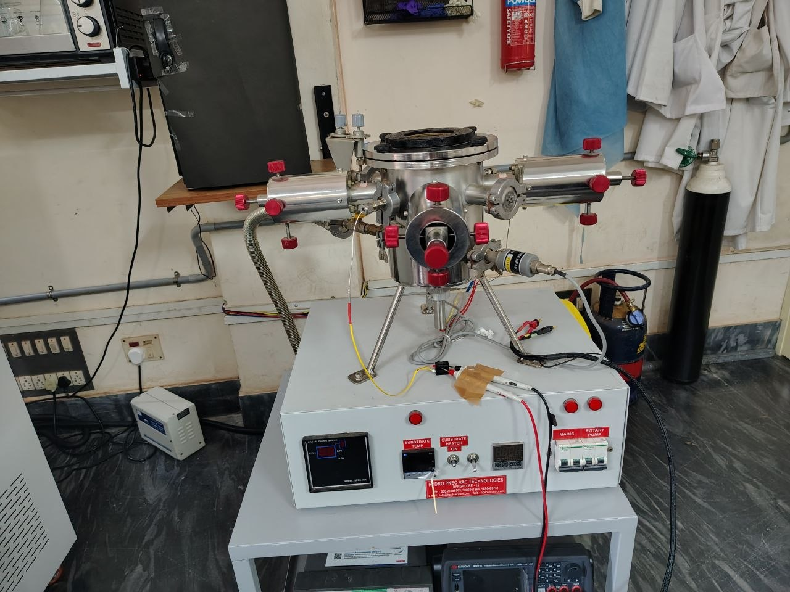
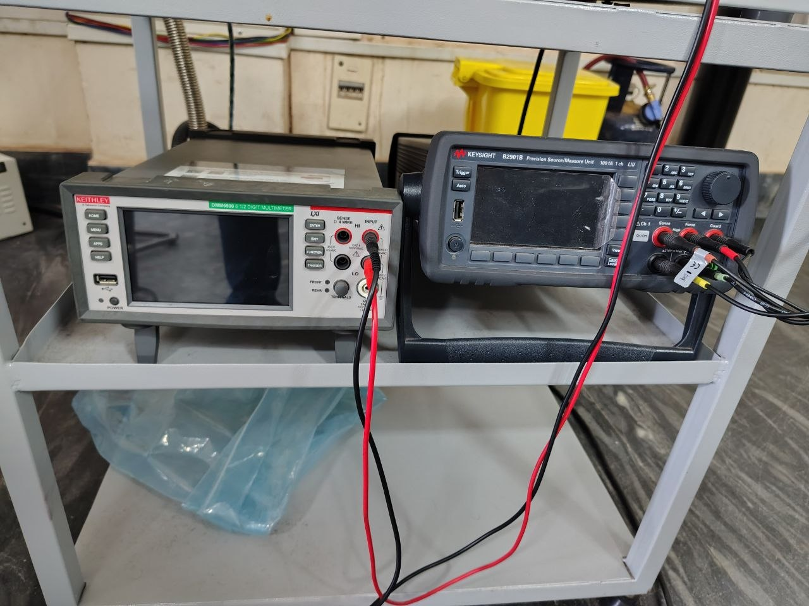
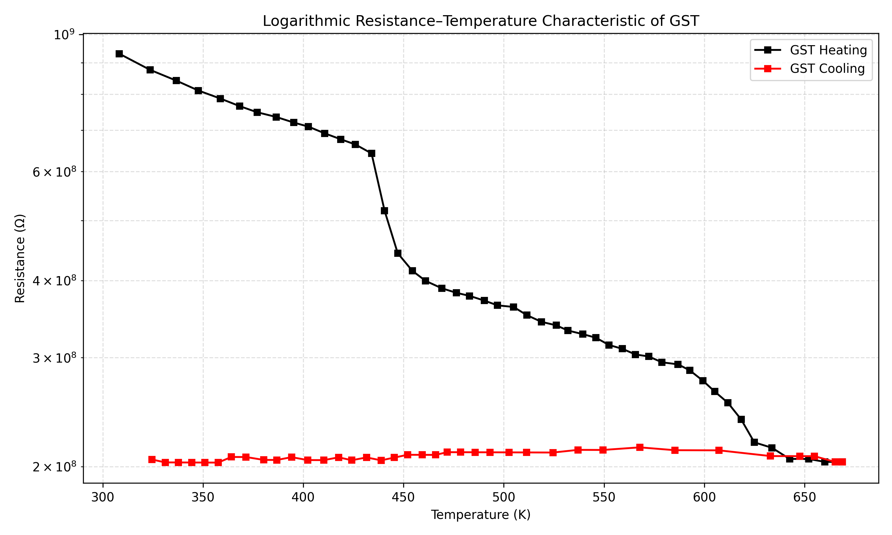

# labdaq-iv

I-V sweeps and R-T (resistance vs temperature) logging on a Keysight B2901B SMU, with sample temperature from a Keithley DMM6500 (K-type thermocouple) and a substrate-heater controller in a vacuum chamber.

## Setup

| Chamber + heater controller | B2901B SMU + DMM6500 |
|---|---|
|  |  |

## Example: GST R-T



Amorphous GST on heating (black) crystallises near 440 K; resistance stays low on cooling (red).
Data: [`GITHUB/GST_DATA.csv`](GITHUB/GST_DATA.csv) (`temperature_k`, `resistance_ohm`; heating rows first, then cooling).

## Files

| File | Purpose |
|---|---|
| `run_iv.py` | I-V sweeps, optionally at a list of temperatures |
| `plot_iv.py` | plot `iv.csv` |
| `run_rt.py` | R-T logging (constant bias, heat/hold/cool profile) |
| `plot_rt.py` | plot `rt.csv`, log R vs T |
| `labdaq/tempctrl.py` | heater-controller backends |
| `modbus_probe.py` | read-only Modbus register scan |
| `rs485_term.py` | raw RS-485 terminal |
| `config_additions.yaml` | `sweep`, `temperature_controller` and `rt` blocks for `config.yaml` |
| `patches/instruments_additions.py` | paste into `labdaq/instruments.py` |
| `requirements_additions.txt` | extra packages |

Needs the base `labdaq` project (`run.py`, `labdaq/instruments.py`, `labdaq/thermocouple.py`).

## Quick start

```
pip install -r requirements_additions.txt

python run_iv.py --sim
python run_iv.py --sample-id S07
python plot_iv.py data/S07/IV_.../iv.csv

python run_rt.py --sim
python run_rt.py --sample-id S07
python plot_rt.py data/S07/RT_.../rt.csv                 # K on x, heating black, cooling red
python plot_rt.py data/S07/RT_.../rt.csv --celsius --save rt.png
```

## Heater controller backends

Chosen in `config.yaml` → `temperature_controller.backend`:

| Backend | Link | I-V (`run_iv.py`) | R-T (`run_rt.py`) |
|---|---|---|---|
| `modbus` | Modbus RTU/ASCII over RS-485 | steps through `temperature_steps_c` | setpoint ramped at `rate_c_per_min` |
| `rs485_ascii` | RS-485, maker's text protocol | same | same, needs `write_sp` |
| `manual` | none, set on the panel | prompt per step | prompt per segment, no ramp |
| `none` | none | sweep at current T | log only, you run the heater |

### Case 1: Modbus

```
python modbus_probe.py --port COM5 --find-slave
python modbus_probe.py --port COM5 --slave 1 --start 4096 --count 20
```

PV register = matches the display. SP register = changes when you change the setpoint on the panel. Fill `pv_register` and `sp_register`. Manual address 40001 = protocol address 0 (fc 3). 4096/4097 are Delta DTB placeholders.

### Case 2: RS-485 text protocol

```
python rs485_term.py --port COM5 --listen 3
python rs485_term.py --port COM5 "01RPV" "01RSP"
python rs485_term.py --port COM5
```

Fill `read_pv`, `read_sp`, `write_sp`, `checksum`, `eol` from the manual or from what works. Send only read commands until you know which one writes. No reply: swap A/B, check baud/parity/address, try `echo: true`.

### Case 3: Manual

`backend: manual`. At each step the script beeps and prints `SET HEATER CONTROLLER TO X C`.
Set it on the panel, then in the terminal: Enter = done, a number = what you actually set, `q` = abort.
The script waits until the sample T is within `arrival_tolerance_c` of the target.
At the end it prints the `end_setpoint_c` to set. Confirmed values go to `metadata.json` → `controller_events`.

## R-T details

Fixed bias on the SMU (voltage mode). R = V/I is logged every `rt.interval_s` with sample T (DMM), controller PV and setpoint, while the heater runs `rt.profile`:

```yaml
profile:
  - {to_c: 400, rate_c_per_min: 5}     # heat
  - {hold_s: 300}                      # hold
  - {to_c: 40, rate_c_per_min: null}   # cool (setpoint jump, natural cooling)
```

- A segment ends when T (from `done_source`) is within `arrival_tolerance_c` of the target, or after `segment_timeout_s` (flagged in metadata). The sample lags the heater, so widen the tolerance or use `done_source: controller`.
- `sp_update_s` ≥ 10 s (30 s default): many controllers save the setpoint to EEPROM on every write.
- `alternate_polarity: true` uses R = (V+ − V−)/(I+ − I−) to cancel offsets and thermo-EMF.
- Compliance points are flagged; their R is not valid.
- In `--sim`, use a fast profile (`rate_c_per_min: 300`, `interval_s: 0.2`, `sp_update_s: 1`). The simulated sample behaves like GST.

Measurement checks: R the same at 0.5 V and 1 V; guard connected properly (never to Force or ground); cables still; first heating of as-deposited GST is irreversible.

## Bring-up (every backend)

1. `--sim` run (`stable_window_s: 10` for speed in I-V)
2. Read-only real run: `temperature_steps_c: null`, `end_setpoint_c: null`
3. Write test: `temperature_steps_c: [40]` (or an R-T profile to 60 C), watch the panel
4. Full plan

Ctrl+C stops safely: SMU to 0 V and off, heater setpoint to `end_setpoint_c`.

## Output

| Run | Folder | Files |
|---|---|---|
| I-V | `data/<sample>/IV_<time>/` | `iv.csv`, `temperature_log.csv`, `metadata.json`, `run.log`, configs |
| R-T | `data/<sample>/RT_<time>/` | `rt.csv`, `metadata.json`, `run.log`, configs |

`rt.csv` columns: `phase` (heating/hold/cooling), `R_ohm`, `temp_C`, `temp_K`, `ctrl_pv_C`, `ctrl_sp_C`, `smu_V`, `smu_I_A`, `compliance`, `error`.
